### Hi there 👋

## Languages and Tools:

#### Languages:

<p align="left">
  
</p>

#### Databases:
 <p align="left">
  
  
</p>

#### Frameworks:
<p align="left">
  
  
</p>

#### OS:
<p align="left">
  
  
  
  
</p>  

#### IDEs:
<p align="left">
  
  
</p>
<p>

[](https://discord.com/users/602846728147959808)
  
</p>

<br />
<br />

<!--START_SECTION:waka-->

```txt
Total Time: 16 hrs 16 mins

Python               13 hrs 7 mins         ████████████████████░░░░░   80.63 %
YAML                 1 hr 41 mins          ██▓░░░░░░░░░░░░░░░░░░░░░░   10.36 %
Markdown             53 mins               █▒░░░░░░░░░░░░░░░░░░░░░░░   05.51 %
JSON                 13 mins               ▒░░░░░░░░░░░░░░░░░░░░░░░░   01.41 %
Text                 10 mins               ▒░░░░░░░░░░░░░░░░░░░░░░░░   01.12 %
```

<!--END_SECTION:waka-->

## 📊 GitHub Stats

<picture>
  <source media="(prefers-color-scheme: dark)" srcset="./profile/stats-dark.svg">
  <source media="(prefers-color-scheme: light)" srcset="./profile/stats-light.svg">
  
</picture>

<p>
<picture>
  <source media="(prefers-color-scheme: dark)" srcset="profile/streak-dark.svg">
  
</picture>
</p>


<p>
<picture>
  <source media="(prefers-color-scheme: dark)" srcset="https://graph.12lua.de/graph?username=12lua&bg_color=0C0E1A&border_color=1C2036&color=A1A1AA&title_color=FAFAFA&line=8A9DE4&point=FAFAFA&area=true&area_color=8A9DE4&radius=16">
  
</picture>
</p>

<table width="100%">
  <tr>
    <td align="left">
      <a href="https://wakatime.com/@018e2a7e-0f00-4f94-bc1d-2b772065ca16">
        
      </a>
    </td>
    <td align="right">
      
    </td>
  </tr>
</table>